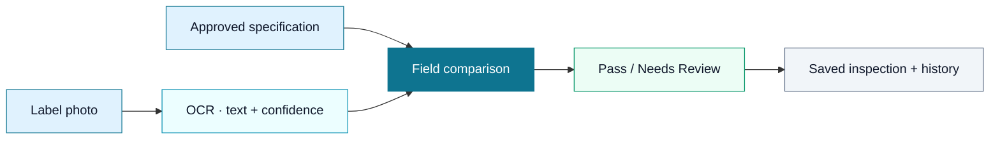

<div align="center">


**Approved specs. Real label photos. Clear answers.**

Compare printed product labels with an approved specification, flag differences, and keep a record of every inspection.

[**Launch VeriLabel —**](https://ai-product-label-verification.vercel.app) · [**Try a sample inspection**](https://ai-product-label-verification.vercel.app/inspect?demo=1) · [**Explore the API**](https://ai-product-label-verification.vercel.app/api/docs)

[](https://github.com/Auth3nticAI/ai-product-label-verification/actions/workflows/ci.yml)


</div>

---

## From approved artwork to an inspectable result

One wrong label can mean wasted packaging, costly reprints, and delayed shipments. VeriLabel helps teams compare what was printed with what was approved, then focus their attention on the fields that need a closer look.


| Built for the checks you already make | What you get |
| --- | --- |
| **Reference** | Save expected text for product names, net contents, ingredients, allergens, and other fields. |
| **Detection** | Extract text and line-level confidence from an uploaded label photo. |
| **Review** | See expected and detected values together, with a status and confidence for each field. |
| **Traceability** | Revisit saved inspections and their results in History. |

## Take the two-minute tour

1. Open [the sample inspection](https://ai-product-label-verification.vercel.app/inspect?demo=1). A sample label with the wrong net weight is loaded for you.
2. Select **Verify Label** to run OCR and compare it with the saved specification.
3. Review the **Needs Review** verdict and the field-by-field differences.
4. Open **History** to revisit the saved result.

To try your own product, create a specification in **Specs**, then choose it in **Inspect** and upload a label photo. The frontend resizes and compresses large photos before upload to fit Vercel's request limit.

> **The sample runs a real inspection.** It uses the API and saves a result; it is not a prerecorded verdict. The illustrations in this README explain the workflow rather than representing a live inspection.

## Understand the verdict

| Field status | Meaning |
| --- | --- |
| **Match** | The detected text matches the approved value. |
| **Incorrect** | A difference was detected with sufficient OCR confidence. |
| **Missing** | An expected field was not found. |
| **Uncertain** | A difference needs human review because OCR confidence is low. |

An inspection returns **Pass** or **Needs Review**. When a mismatched field has OCR confidence below **0.90**, it is marked **uncertain** rather than **incorrect**. See measured examples and response shapes in the [API contract](docs/api-contract.md).

## Under the hood



| Layer | Technology | Location |
| --- | --- | --- |
| Interface | Next.js, React, TypeScript, Tailwind CSS | [`frontend/`](frontend/) |
| API & comparison | FastAPI, Pydantic, SQLAlchemy | [`backend/app/`](backend/app/) |
| Text extraction | RapidOCR with ONNX Runtime | [`ocr.py`](backend/app/ocr.py) |
| Storage | SQLite locally; Neon PostgreSQL in production | [`database.py`](backend/app/database.py) |
| Hosting | Vercel; frontend and `/api/*` on the same origin | [Deployment guide](docs/deployment.md) |
| Billing | Stripe Checkout, webhooks, Customer Portal; test mode only | [Billing decision](docs/adr/0003-pricing-and-stripe-billing.md) |

Pricing includes Starter, Professional, and Enterprise with monthly and annual options. **Billing runs in a Stripe test-mode sandbox and does not accept real payments** (use card 4242 4242 4242 4242). Plan limits are displayed for comparison and are not enforced. Billing identity currently uses a signed browser cookie; user accounts are planned.

## Run locally

Use **Python 3.12** and **Node.js 24** to match CI. Start the backend and frontend in separate terminals.

### 1 · Start the API

```powershell
cd backend
python -m venv .venv
.venv\Scripts\Activate.ps1
pip install -r requirements.txt
uvicorn app.main:app --reload --port 8000
```

On macOS/Linux, activate with `source .venv/bin/activate`. Local storage defaults to SQLite. Interactive API documentation is at **http://localhost:8000/docs**.

### 2 · Start the frontend

```powershell
cd frontend
npm ci
npm run dev
```

Open **http://localhost:3000**. The frontend uses the local API by default; see [`api.ts`](frontend/src/lib/api.ts) for `NEXT_PUBLIC_API_URL` configuration. Stripe is optional for label inspection.

### 3 · Run the checks

From the repository root, with the backend virtual environment active:

```powershell
# Backend unit tests
cd backend
pytest -q

# End-to-end tests — keep the local API running in another terminal
cd ../tests/e2e
pytest -q -rx

# Frontend checks
cd ../../frontend
npm run lint
npm run build
```

The E2E suite creates test specs and inspections: use a local database for a full run. For a deployed smoke check, follow the documented `E2E_READONLY=1` procedure in the [deployment guide](docs/deployment.md).

## Project map

```text
frontend/           Next.js interface and product interactions
backend/app/        API, OCR, verification, storage, and billing
backend/tests/      Backend unit and integration tests
data/sample_labels/ Sample images, approved specs, and answer key
tests/e2e/          HTTP tests for the complete inspection flow
docs/               API contract, architecture, deployment, and QA
skills/             Repeatable testing playbook for AI agents
```

## Find your next step

| I want to… | Read this |
| --- | --- |
| Understand requests and responses | [API contract](docs/api-contract.md) |
| Explore the system and decisions | [Architecture](docs/architecture.md) · [ADRs](docs/adr/) |
| Test with real product labels | [Web label testing guide](docs/web-label-testing.md) |
| Check demo readiness | [Readiness checklist](docs/demo-readiness.md) · [QA plan](docs/qa-test-plan.md) |
| Deploy or diagnose production | [Deployment guide](docs/deployment.md) |
| Contribute with an AI coding agent | [Agent instructions](AGENTS.md) · [Muse setup](docs/muse-setup.md) |

## The team

Built for **CSE 651 · Software Development with Agentic AI**, with a demonstration on **October 20, 2026**.

| Team member | Focus |
| --- | --- |
| **Tray** | Technical leadership, OCR, deployment, and documentation |
| **Wenyi** | Frontend experience |
| **Amzad** | Backend API, data models, and verification |
| **Vincent** | QA, end-to-end testing, and demo readiness |

Contributions start from the latest `main` on a fresh feature branch. Open a PR with its issue reference and test results; backend tests, local E2E, and frontend lint/build must pass. Keep the [API contract](docs/api-contract.md) in sync and record AI assistance in the [usage log](docs/ai-usage.md). See [AGENTS.md](AGENTS.md) for ownership and the full workflow.

---

<div align="center">

**Catch label mistakes before your next production run.**

[Open VeriLabel](https://ai-product-label-verification.vercel.app) · [Report an issue](https://github.com/Auth3nticAI/ai-product-label-verification/issues)

</div>
