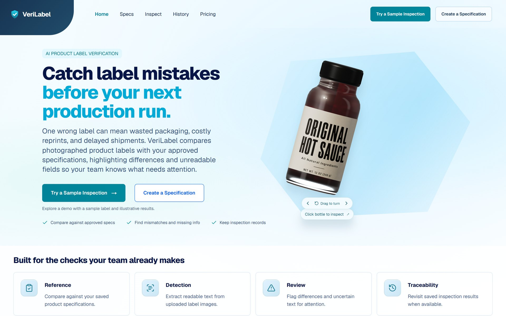
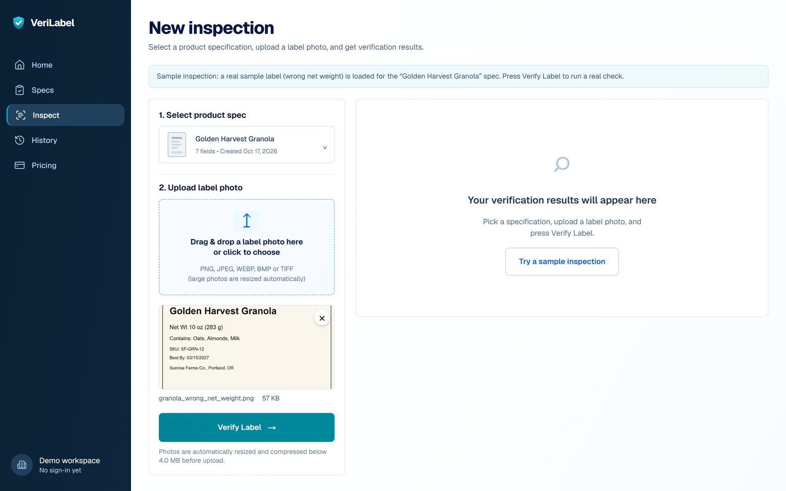
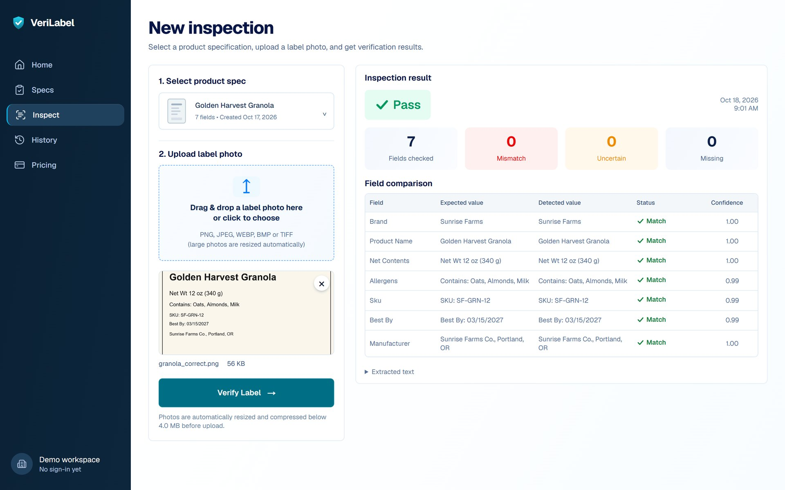
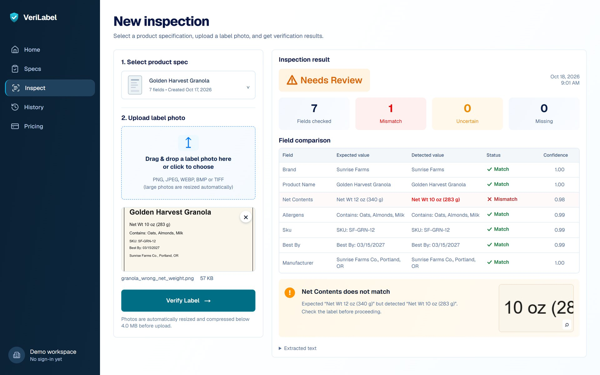
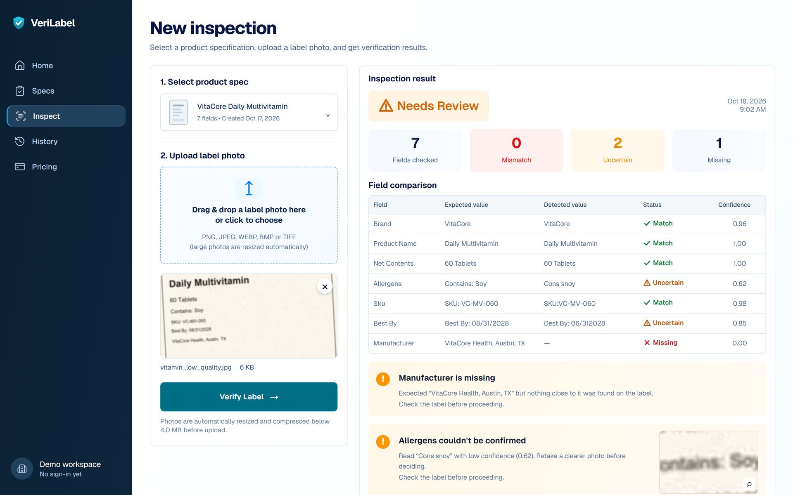
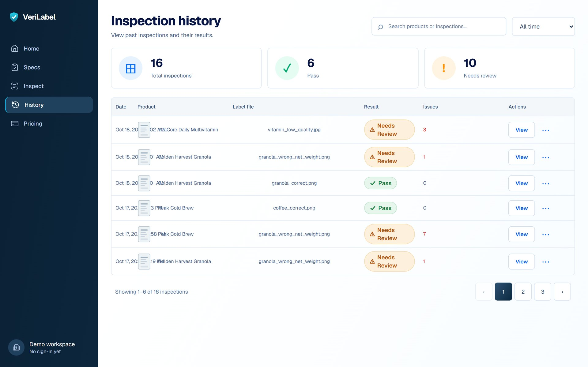
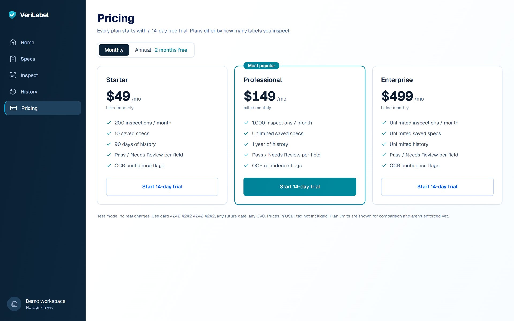
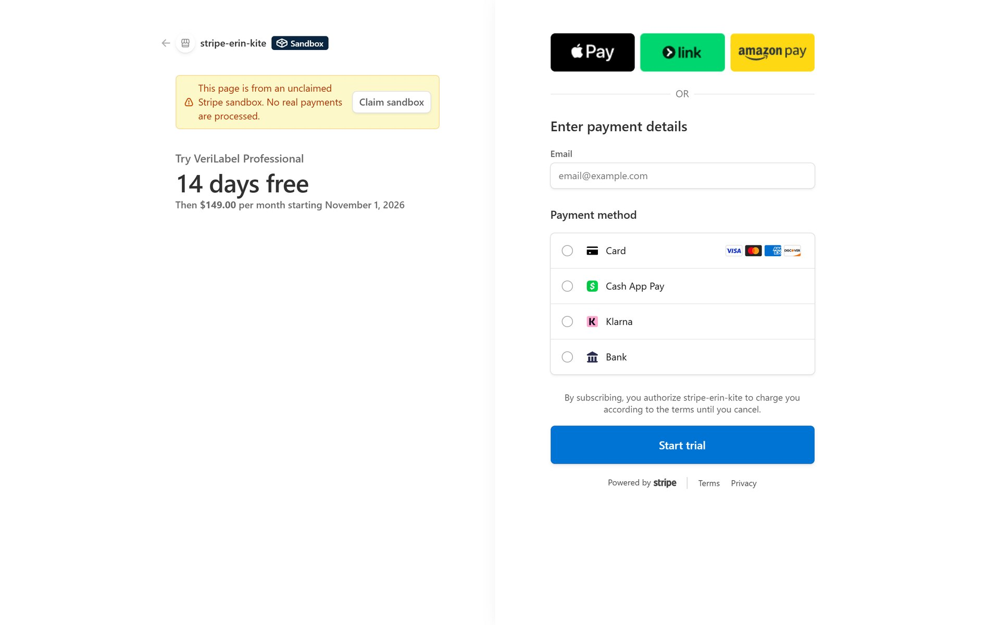
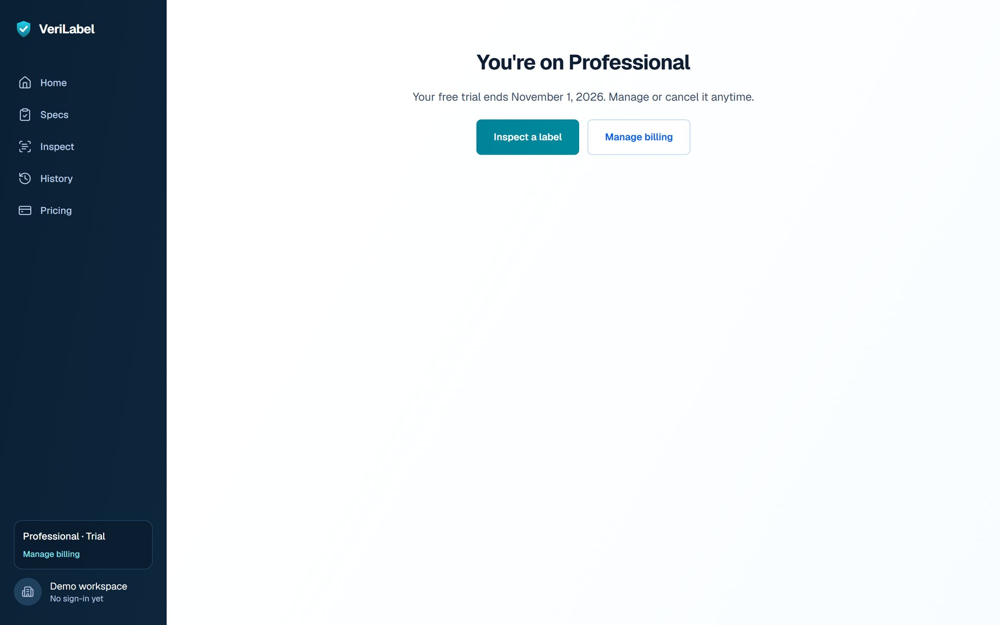
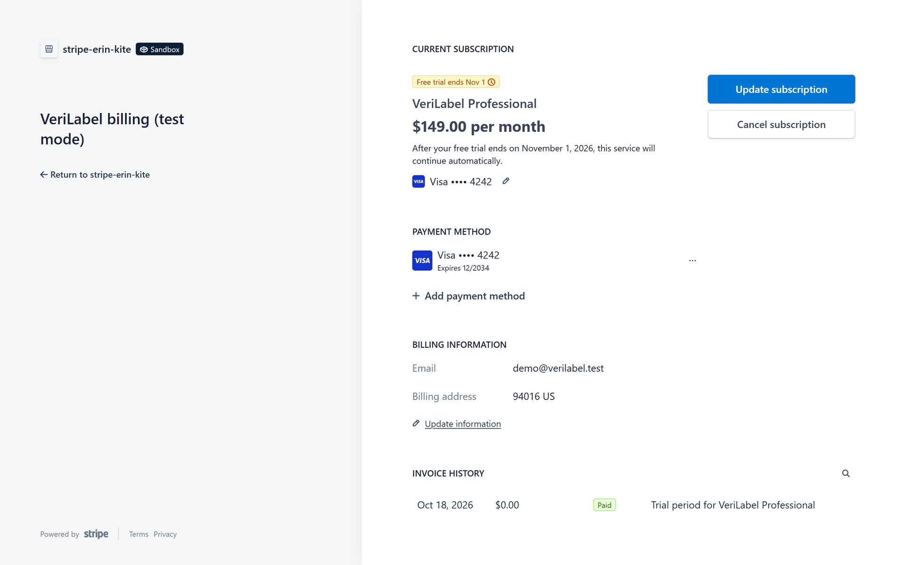

# VeriLabel demo guide

**For:** the presenter (**one person** presents the whole demo; the team picks who) · **Demo:** Tue Oct 20 · **Rehearsal:** Mon Oct 19
**Live app:** https://ai-product-label-verification.vercel.app · **Deck:** VeriLabel Demo Deck (link in the team chat)

Every screenshot below is from the live site (Oct 18), captured by a real browser walking this exact script, including a Stripe test checkout. If the network fails on stage, show these instead.

---

## 30 minutes before

- [ ] Open https://ai-product-label-verification.vercel.app/api/health and check it says `"database":"postgresql"`.
- [ ] **Warm up OCR:** upload any label once. The first scan after the site has been idle takes 8–11 s; after that it's about 2 s.
- [ ] Download these from `data/sample_labels/` to the presenting laptop: `granola_correct.png`, `granola_wrong_net_weight.png`, `vitamin_low_quality.jpg`.
- [ ] Open a **separate incognito window** for the pricing demo (each browser is its own workspace; one that already subscribed shows "Current plan" instead of a new checkout).
- [ ] Tabs ready: the app, the deck, GitHub (a merged PR, Actions, `skills/labelguard-testing`).
- [ ] Zoom the browser to 125% so the room can read the field table.
- [ ] **Before Tuesday:** collect one example from each teammate for the AI slide (one thing they delegated to an agent, one thing they reviewed or rejected).

## Running order (≈12 minutes)

One presenter runs everything: slides and the live browser. Keep the deck in one window and the app in another (plus an incognito window for step 6).

| Time | Slides | What |
|---|---|---|
| 0:00 | Cover, problem | The problem in one line |
| 1:00 | How it works | Spec → photo → verdict; the four statuses |
| 2:00 | Live demo | Steps 1–5 below |
| 6:00 | Uncertain | Why confidence matters (step 4) |
| 7:00 | Pricing, Stripe | Step 6 below |
| 9:00 | Architecture, quality | How it's built and tested |
| 10:30 | AI-assisted development | What the team delegated to agents, and what review caught |
| 11:30 | Limits, close | Say the limits before anyone asks; Q&A |

---

## The script

### 1. Home → Try a Sample Inspection

Click **Try a Sample Inspection**. It loads a real sample label (wrong net weight) and selects the **Golden Harvest Granola** spec.

> **Say:** "This is a real label photo and a real spec. Nothing on this screen is a mock-up."

### 2. A correct label passes

On **Inspect**, keep *Golden Harvest Granola*, upload `granola_correct.png`, press **Verify Label**.

> **Say:** "All seven fields match. Each row shows what we expected, what OCR read, and how confident it was."

### 3. A wrong net weight is caught

Upload `granola_wrong_net_weight.png` → **Verify Label**.

> **Say:** "Expected 12 oz, the label says 10 oz. The close-up on the right is cropped from the photo so a reviewer sees the evidence."

### 4. A blurry photo is *uncertain*, not *incorrect*

Switch the spec to **VitaCore Daily Multivitamin**, upload `vitamin_low_quality.jpg` → **Verify Label**.

> **Say:** "This label is actually correct, but the photo is bad. OCR read the date as 06/312028 with 0.85 confidence. Below 0.90 we say *couldn't be confirmed, retake the photo* instead of rejecting a good batch."

If asked why Manufacturer says *Missing*: OCR couldn't read that line from this photo at all. The overall verdict is still *Needs Review*, which is the right call.

### 5. History

Open **History**; your inspections are at the top. Click **View** on one.

### 6. Pricing and Stripe (use the incognito window)

**Pricing** in the nav. Toggle **Annual** to show "2 months free", then back to Monthly.

Professional → **Start 14-day trial**. On Stripe's page:

1. Choose **Card**.
2. **Untick "Save my information with Link"** (otherwise Stripe asks for a phone number).
3. Email: anything (`demo@verilabel.test`). Card `4242 4242 4242 4242`, expiry `12 / 34`, CVC `123`, name anything, ZIP `94016`.
4. **Start trial**.

You land on "Confirming your subscription…", then "You're on Professional". The sidebar shows **Professional · Trial**.

Click **Manage billing** to show Stripe's portal (plan, card ending 4242, the $0 trial invoice).

> **Say:** "Stripe handles payment, renewals and cancellation. Our webhook is the only thing that writes plan state: it checks Stripe's signature and re-reads the subscription from Stripe, so events arriving out of order can't corrupt it. Test mode, no real money."

Stripe's page shows a yellow **"unclaimed Stripe sandbox"** banner and the merchant name **stripe-erin-kite**. If asked: it's the auto-created test sandbox. (Claiming it and setting the business name to VeriLabel removes both; that's a dashboard step.)

---

## If something goes wrong

| Problem | Do this |
|---|---|
| Site won't load | Switch to the deck: slides 4–9 are these screenshots. Keep talking. |
| First scan spins ~10 s | Normal after idle (cold start). Talk through the field table while it loads. |
| A verdict differs from this guide | Say "live system", move on; note it for the QA log. Never fake it. |
| Stripe asks for a phone number | You missed step 6.2: untick "Save my information with Link". |
| Pricing shows "Current plan" | That browser already subscribed. Use a new incognito window. |
| Checkout says "Use Manage billing" | Same cause: that workspace has a live subscription. |

## Likely questions

- **Why OCR instead of GPT-4 vision?** OCR gives a confidence score per line, which is what lets us say "uncertain" instead of guessing. It's also free, fast and works offline.
- **What about accounts and teams?** Planned: Clerk Organizations, so each QA team owns its specs and subscription (ADR 0004).
- **Is billing secure?** Signed webhooks, test-mode-only keys (the backend refuses live keys), a signed workspace cookie, and return URLs only to our own domain.
- **How do you know it's right?** 9 sample labels with an answer key, 8/8 real manufacturer label cases, 178 backend tests, and an end-to-end check against the live site after every deploy.

## After the rehearsal

Specs you created for practice: Specs → ⋯ → **Delete** (only works for specs with no inspections). Leave the three sample specs alone.

---

*Screenshots: `docs/assets/screenshots/` (Oct 18, live site). To recapture after UI changes, rerun the same walk-through and replace the files with the same names.*
